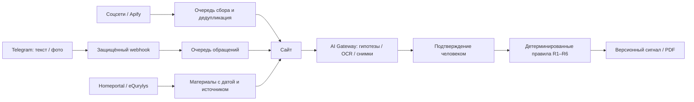

# SAQ QURYLYS

Система проверки рекламы строящегося жилья в Казахстане: публикация → объект → доказательства → объяснимый риск → решение → сигнальная карточка.

[Рабочий сайт](https://saq-qurylys-one.vercel.app) · [Telegram-бот](https://t.me/saq_qurylysbot) · [Соответствие кейсу](docs/CASE_MATRIX.md) · [Сценарий защиты](docs/PITCH.md)

## Назначение и пользователи

**Сайт — рабочее место аналитика.** Здесь проверяют публикации и обращения, сопоставляют объекты с реестрами, подтверждают факторы риска и формируют сигналы. Доступ по учётной записи; публичной регистрации и стандартного пароля нет.

**Telegram-бот — канал для жителей.** Пользователь отправляет текст или скриншот объявления, получает предварительную оценку и номер обращения. Материал появляется на сайте в очереди проверок. Решение сотрудника пока не отправляется обратно в Telegram автоматически.

Продукт определяет приоритет проверки. Баллы не являются вероятностью нарушения или юридическим заключением.

## Навигация для технического жюри

- [Быстрый запуск](#быстрый-запуск) — локальная работа без внешних ключей.
- [Приёмочный сценарий](#приёмочный-сценарий) — обязательный кейс на изолированных данных.
- [Архитектура](#архитектура) — границы модулей и движение данных.
- [Скоринг и ИИ](#скоринг-и-ии) — формула, подтверждения, ограничения модели.
- [Интеграции](#интеграции) — что действительно подключено.
- [Проверки](#проверки) — воспроизводимые команды.
- [Развёртывание](#развёртывание) — настройки и эксплуатационные границы.

## Быстрый запуск

Требуются Git, Node.js **24.15+ ветки 24.x** и npm. Точная версия CI — в [.nvmrc](.nvmrc).

```bash
git clone https://github.com/legacy69cat/saq-qurylys.git
cd saq-qurylys
npm ci
cp .env.example .env.local
npm run db:setup
npm run db:import
npm run dev
```

Откройте [localhost:3000](http://127.0.0.1:3000). Импорт необязателен: он добавляет публичную выборку из `data/real-projects.json`, не перезаписывая существующие объекты. Это выборка, а не полный реестр города.

По умолчанию используются локальная SQLite и режим без входа. Сервер слушает `127.0.0.1`. Без ключей доступны реестр, карта, ручная работа, предварительная оценка текста и сигнальные карточки. ИИ и сбор соцсетей требуют отдельных настроек.

При обновлении существующего проекта **не заменяйте свой `.env.local`**. Обновите зависимости и схему:

```bash
npm ci
npm run db:migrate
npm run build
npm start
```

Текущая схема БД — **7**. Миграции повторяемы; схема 7 добавляет очередь Telegram.

## Приёмочный сценарий

Изолированная демонстрация не изменяет рабочую БД:

```bash
npm run build
npm run verify:case
npm run demo
```

Откройте [localhost:3300](http://127.0.0.1:3300). Создаются временные **8 ЖК и 12 публикаций**. Все сведения вымышлены и отмечены в интерфейсе. Сбор соцсетей и облачная БД отключены. Временная база удаляется при остановке.

1. Откройте обзор и сравните A/B/C: **35 / жёлтая**, **70 / красная**, **10 / зелёная**.
2. Откройте «Контур 07», добавьте новое объявление с предложением депозита и явным указанием строительства.
3. Для живого ИИ запустите демо командой `npm run demo -- --ai`, предварительно задав ключ и модель. Проверьте цитаты; до подтверждения гипотез балл не меняется. Без ключа доступна ручная гипотеза.
4. Подтвердите R2 и R3: при уже подтверждённом R1 балл изменится с 35 до 70.
5. Создайте сигнал, верните на доработку с комментарием, создайте следующую версию, подтвердите и сохраните PDF через печать.

Дополнительный сценарий: отправить объявление боту → открыть `/inbox` → взять обращение на проверку → завершить с комментарием. Статус обращения и подтверждённый риск ЖК — разные сущности; закрытие обращения не начисляет баллы объекту.

## Архитектура

**Стек:** Next.js 16, React 19, TypeScript, Node.js 24, SQLite/Turso, Vercel AI SDK, Leaflet/OpenStreetMap, Playwright, Vitest. Точные версии закреплены в `package-lock.json`.



| Каталог | Ответственность |
|---|---|
| `src/domain` | Чистые правила риска, оценка текста, валидация, работа с адресами |
| `src/server/db` | Миграции, транзакции, публикации, доказательства, журнал, версии сигналов |
| `src/server/ai` | Вызовы модели, проверка ответа и цитат, OCR |
| `src/server/social` | Apify, ограниченная очередь, опрос результатов и расписание |
| `src/server/registries` | Публичные запросы Homeportal/eQurylys, сохранение результатов |
| `src/server/telegram` | Bot API, дедупликация, лимиты, отчёт и очередь обращений |
| `src/server/auth` | Учётные записи, роли, сессии и серверная проверка прав |
| `src/app`, `src/components` | Страницы, серверные действия и интерфейс |
| `tests`, `scripts` | Автоматическая приёмка и служебные команды |

Локальная SQLite и облачная Turso используют общий асинхронный интерфейс. Секреты и вызовы внешних сервисов остаются на сервере. Гипотезы ИИ отделены от подтверждённых факторов. Сигнал хранит снимок материалов и балла: последующие изменения объекта не переписывают старую версию.

## Скоринг и ИИ

| Фактор | Условие | Вес |
|---|---|---:|
| R1 | Документированное отсутствие применимого правового основания | 35 |
| R2 | Прямое предложение внести деньги за приобретение жилья | 25 |
| R3 | Реклама жилья с подтверждением незавершённого строительства | 10 |
| R4 | Подтверждённое коллективное обращение | 15 |
| R5 | Расхождение сопоставимых оценок готовности от 20 процентных пунктов | 10 |
| R6 | Документированный простой или просрочка | 5 |

Каждый фактор учитывается один раз, сумма ограничена 100. Зоны:

- **0–24:** зелёная; неизвестность при этом не означает безопасность.
- **25–59:** жёлтая.
- **60–100:** красная только при одновременно подтверждённых R1 и R2; иначе жёлтая.

Отсутствие записи в поиске не подтверждает R1. Гипотезы и неизвестные факты не добавляют баллы. Повторные объявления не умножают вес фактора.

**Три разных применения ИИ:**

1. В карточке ЖК модель предлагает только R2/R3: цитату, объяснение и уверенность. Код проверяет структуру, наличие цитаты и обрезанный контекст отрицаний. Решение остаётся за человеком.
2. Для скриншота модель распознаёт текст. Предварительный отчёт бота и страницы проверки строится общими текстовыми правилами, а не свободным ответом модели.
3. Для снимков с дрона модель описывает видимые элементы по пяти пунктам. Невидимый элемент не объявляется отсутствующим за пределами кадра; результат не является разрешением на строительство.

Используется предобученная модель через Vercel AI Gateway; собственное обучение не проводилось. На стенде использовалась `google/gemini-2.5-flash`, модель выбирается переменными окружения. Уверенность модели не является вероятностью нарушения.

**Статус live-приёмки:** инструкция `saq-ad-3` имеет расширенный набор из 12 учебных примеров. Полная повторная проверка после исправлений пока не завершена из-за HTTP 429 Gateway. Не заявляем измеренную точность на реальной выборке. Отдельные ошибки лимита, доступа и тайм-аута не уничтожают сохранённую публикацию; ручной путь остаётся доступным.

## Интеграции

| Источник | Реализовано | Ограничения |
|---|---|---|
| TikTok, Facebook, Instagram / Apify | Поиск RU/KZ, 48 фраз, очередь, дедупликация, архив, постраничный импорт | Не полный охват площадок; до 1000 записей за импорт, достижение предела отмечается |
| Homeportal | Публичный поиск разрешений, гарантий и опубликованных предупреждений по БИН/названию | До трёх страниц на раздел; результаты требуют сопоставления объекта и очереди |
| eQurylys | Проверка организации по точному БИН | Наличие организации не подтверждает разрешение конкретного ЖК |
| Другие реестры РК | Справочник ссылок для проверки | Автоматическая интеграция не заявляется |
| Photon | Кандидаты координат по адресу | Координаты подтверждаются перед добавлением объекта |
| OpenStreetMap | Подложка карты | На карте только объекты базы с координатами |
| Telegram | Текст/фото → оценка → обращение на сайте | Нет видео, аудио, PDF, открытия ссылок и обратной отправки решения сотрудника |

Сбор соцсетей ограничен **$1 за скользящие 24 часа**, до $0,50 на TikTok и $0,20 на Facebook/Instagram за запуск. Ежедневный Vercel Cron и уведомления Apify продолжают очередь в рамках бюджета. Тот же Cron проверяет до шести давно не проверявшихся объектов по открытым реестрам. Недоступность источника сохраняется как незавершённая проверка.

## Настройки

Скопируйте [.env.example](.env.example). Секреты храните только в игнорируемом `.env.local` или переменных Vercel, без префикса `NEXT_PUBLIC_`.

| Переменные | Назначение |
|---|---|
| `DATABASE_PATH` | Путь к локальной SQLite |
| `TURSO_DATABASE_URL`, `TURSO_AUTH_TOKEN` | Облачная БД; при заданном URL имеет приоритет |
| `APP_ENV`, `SAQ_AUTH_MODE`, `SAQ_DEMO_MODE` | Для production: `production`, `session`, `0` |
| `APP_URL` | HTTPS-адрес для origin и webhook |
| `AI_GATEWAY_API_KEY`, `AI_GATEWAY_MODEL` | ИИ-анализ текста |
| `DRONE_AI_MODEL` | Модель с изображениями для OCR и дрона |
| `APIFY_TOKEN`, `APIFY_WEBHOOK_SECRET`, `CRON_SECRET` | Сбор и защищённые фоновые вызовы |
| `TELEGRAM_BOT_TOKEN`, `TELEGRAM_WEBHOOK_SECRET` | Бот и проверка подлинности webhook |
| `PHOTON_API_URL` | Необязательная замена сервиса геокодирования |

## Проверки

```bash
npm run check                 # lint, типы, unit/integration, сборка
npx playwright install chromium
npx playwright test           # браузерные сценарии, включая очередь обращений
npm run test:auth             # сессии и права доступа
npm run verify:case           # состав демо и контрольные баллы A/B/C
```

GitHub Actions запускает проверки на чистой установке без внешних ключей. Тесты используют временные базы. Успешный CI не подтверждает доступность внешних API — для них выполняются отдельные живые проверки.

```bash
npm run test:ai:live          # 12 учебных примеров, реальные запросы модели
npm run test:case:live        # браузер → реальный ИИ → решение → сигнал → PDF
```

Последние две команды расходуют кредиты и требуют настройки Gateway. Вторая сохраняет видео, PDF и скриншот в `test-results/live-case`. Тест не подменяет провайдера; при лимите/ошибке результат нельзя считать успешным.

## Развёртывание

1. Подключить проект Vercel и отдельную Turso для production.
2. Задать переменные, выполнить миграции и создать учётную запись через `npm run users` согласно инструкции развёртывания.
3. Проверить `APP_ENV=production`, `SAQ_AUTH_MODE=session`, `SAQ_DEMO_MODE=0` и HTTPS `APP_URL`.
4. Опубликовать, настроить Telegram webhook через `npm run telegram:setup` и проверить его состояние.
5. Проверить вход, карту, запись материалов, очередь обращений и доступность внешних сервисов.

Preview не должен использовать рабочую БД. Не публикуйте `.env`, токены и учётные данные вместе с репозиторием. Публичный `/api/liveness` подтверждает доступность приложения, а не здоровье всех интеграций.

Подробности: [Vercel и rollback](deploy/VERCEL.md) · [Telegram](docs/TELEGRAM_BOT.md) · [Архитектура](docs/ARCHITECTURE.md) · [Дрон](docs/DRONE_INSPECTION.md).

## Данные, безопасность и границы готовности

- Пароли хешируются scrypt; серверные сессии и роли `admin/analyst/viewer` проверяются на сервере. Webhook защищены секретами, повторные Telegram updates дедуплицируются.
- Текст обращения и OCR-текст сохраняются в `telegram_inbox`. Исходный снимок не сохраняется; имя и chat_id не копируются в очередь. Технические идентификаторы чатов используются отдельно для лимитов доставки.
- Закрытие обращения сохраняет последнее решение, автора и дату. Полной истории редакций очереди и автоматического срока удаления обращений пока нет.
- OCR и визуальный анализ могут ошибаться. Точность на размеченных снимках стройплощадок Казахстана не измерялась.
- Нет гарантии полного сбора соцсетей, всех государственных интеграций или доставки Telegram ровно один раз при любом сетевом сбое.
- SSO/MFA, нагрузочная приёмка, проверенное восстановление облачной БД и регламент хранения данных остаются задачами перед широким промышленным запуском.

Для сдачи зафиксируйте SHA проверенной версии и результат CI. Матрица обязательных требований, доказательства проверок и оговорки: [docs/CASE_MATRIX.md](docs/CASE_MATRIX.md).
